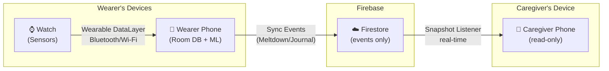
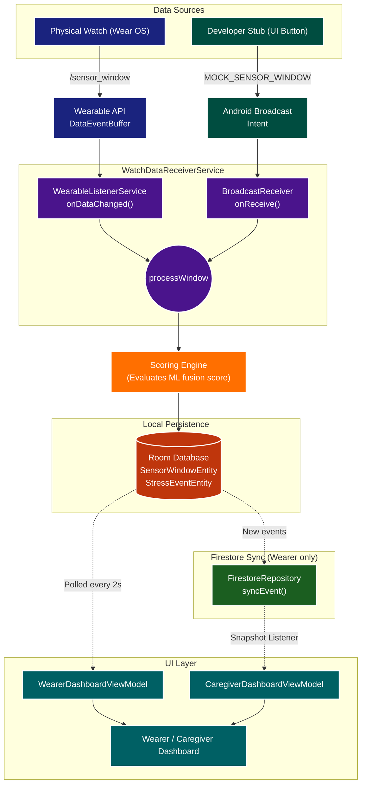

# 02. System Architecture

The project is split into three tightly-coupled Gradle modules to separate concerns between the watch, the phone, and their shared contracts.

## Module 1: `:mobile` (The Phone App)
- **Role:** Dashboard for both Wearer and Caregiver roles, ML Scoring Engine, Firestore sync layer.
- **Tech Stack:** Jetpack Compose (Material 3), MVVM, `StateFlow`, Firebase Auth + Firestore.
- **Key Components:**
  - `AppViewModel`: Manages global app state (Auth, Role, Pairing Flow).
  - `WearerDashboardViewModel`: Calculates the Fusion Score continuously based on incoming telemetry, manages local Room DB, and syncs derived data to Firestore.
  - `CaregiverDashboardViewModel`: Read-only listener watching Firestore snapshots to present the wearer's live status.
  - `WatchDataReceiverService`: Intercepts `/sensor_window` and `/sos_location` payloads from the watch.
  - `FirestoreRepository`: Manages user profiles, pairing, and data sync between wearer and caregiver accounts.
  - `RoleSelectionScreen`: First-time role selection (WEARER or CAREGIVER).
  - `PairingScreen`: 6-digit code generation (wearer) and code entry (caregiver) for account linking.

## Module 2: `:wear` (The Wearer Watch Interface)
- **Role:** Sensor collection, SOS GPS Responder, and minimal UI.
- **Tech Stack:** Wear Compose, Foreground Services (Type `health`), `FusedLocationProviderClient`.
- **Key Components:**
  - `SensorCollectionService`: Runs continuously to fetch Heart Rate via Samsung Health SDK.
  - `PingResponderService`: Listens for `/sos_gps_request` and triggers the `LocationTracker`.

## Module 3: `:core-detection` (Shared Resources)
- **Role:** Enforces API contracts and local persistence across both apps.
- **Key Components:**
  - `DataLayerSchema`: Centralized constants for all Wearable API paths and keys.
  - `AppDatabase`: Shared Room Database entities (e.g., `StressEventEntity`, `SensorWindowEntity`).

## The Data Layer API Contract
All watch↔phone communication occurs via Google Play Services Wearable API (local Bluetooth/Wi-Fi).

| Sender | Receiver | Path | Payload (DataMap keys) | Purpose & Frequency |
|---|---|---|---|---|
| Wear | Phone | `/sensor_window` | `timestamp`, `hr_mean`, `rmssd`, `acc_mag` | Streams raw physiological telemetry. **Frequency: Every 2 seconds.** |
| Phone | Wear | `/sos_gps_request` | *(Empty ByteArray Message)* | Phone commands the Watch to fetch GPS. **Frequency: Only during Tier 2 event.** |
| Wear | Phone | `/sos_location` | `timestamp`, `latitude`, `longitude` | Watch returns the SOS GPS coordinates. **Frequency: Once per Tier 2 event.** |
| Wear | Phone | `/event_start` | `timestamp`, `trigger` | Wearer tapped "I need help". **Frequency: Event-driven.** |

## Multi-Device Sync Architecture

### What syncs to Firestore (and what doesn't)
| Data | Syncs? | Frequency / Volume | Reason |
|---|---|---|---|
| Stress events (start, end, label) | ✅ Yes | **Event-driven** (~3-10 writes/day) | Caregiver needs journal + pattern review |
| Current status (stress %, tier, activity) | ❌ No | **Never** (0 writes) | Removed to save cloud cost/battery. Caregiver only needs alerts. |
| Raw sensor windows (HR, HRV, accel) | ❌ No | **Never** (0 writes) | Privacy: raw biometrics stay on-device |
| GPS coordinates | ❌ No | **Never** (0 writes) | Only shared via push notification on Tier 2 |

## Data Transmission Pipeline (Including Stubs)

The data pipeline strictly adheres to an "I -> S -> OUT" architecture. To ensure absolute parity between development testing and production, the Developer Stubs do **not** bypass any logic and do **not** write directly to the database. Instead, they emulate physical watch events by emitting Android Broadcasts that are intercepted by the exact same receiver pipeline as production Wear OS telemetry.

## UI Architecture (`android/mobile/src/main/java/com/mtpnda/biocue/ui/`)

To prevent "God Objects" and make debugging scalable, the UI is decoupled from the main activity and split by domain:

- `screens/wearer/WearerDashboardScreen.kt`: Exclusively renders the Wearer interface (stress meter, stub controls, journal).
- `screens/caregiver/CaregiverDashboardScreen.kt`: Exclusively renders the Caregiver interface (pattern review, alerts). **Does not contain wearer telemetry UI**, ensuring caregiver bounds are physically impossible to violate.
- `screens/profile/ProfileScreen.kt`: Full-page user profile with language toggles (EN/ID) and Firebase logout.
- `components/DashboardComponents.kt`: Reusable, stateless widgets (e.g., `JournalCard`, `PatternReviewCard`, `LabelBtn`).
- `theme/Color.kt`: Centralized source of truth for semantic colors (e.g., `CalmColor`, `DangerColor`).
- `Previews.kt`: Centralized hub for `@Preview` annotations to enforce visual parity during development (Complete Wearer, Debug Wearer, Complete Caregiver).

`MainActivity.kt` acts exclusively as the **Top-Level Navigation Router**. It runs a simple compose state machine (`if/else` on `AppViewModel` auth/role states) and injects the necessary `ViewModels` into the respective screen routes.
